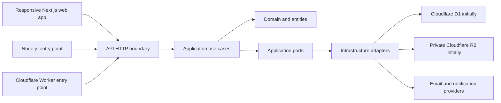

# Architecture

## Status

This is the agreed architecture baseline, not a description of implemented code. Keep the application modular, testable, and replaceable. Add packages or layers only when they have a clear responsibility.

## System shape



The Node.js and Cloudflare Worker entry points must call the same application behavior through isolated runtime adapters. Local Node.js success does not prove that the Worker runtime supports a dependency or API.

Maintain a current record of each material Node.js/Workers incompatibility, the affected capability, its workaround or adapter, and remaining limitations. Validate compatibility in the actual Worker runtime; do not silently compromise required behavior.

### Current runtime compatibility

The health use case contains no HTTP or runtime dependencies. Both adapters invoke the same Web `Request`/`Response` handler. API tests exercise a real Node HTTP listener and Miniflare's local Workerd runtime (compatibility date `2026-07-30`); they do not prove compatibility in a deployed Worker.

| Capability   | Difference and current handling                                                                                                            | Remaining limitation                                                                                                                                                  |
| ------------ | ------------------------------------------------------------------------------------------------------------------------------------------ | --------------------------------------------------------------------------------------------------------------------------------------------------------------------- |
| HTTP server  | Node uses `node:http` in a separate adapter; Workers supply Web requests to `fetch`.                                                       | The local server binds only to `127.0.0.1:8787` and constructs request URLs with `http://localhost` as the origin; do not depend on the original host or scheme.      |
| Streams      | Node's stream types differ from DOM streams; the adapter bridges request bodies into a Web stream.                                         | The Node adapter buffers responses. It is not suitable for large file downloads or production traffic until streaming and resource limits are implemented and tested. |
| Logging      | Both runtimes use a small logging port backed by `console`; failures emit fixed event names without request contents or exception details. | Structured context and deployed log retention remain to be designed; no routine health requests are logged.                                                           |
| Dependencies | The Worker bundle contains only the shared health and HTTP boundary, not the Node adapter.                                                 | No other dependencies or provider bindings have been verified in Workers; test each new capability in Workerd and the deployed runtime.                               |

## Technology decisions

| Concern               | Decision                                                                                 |
| --------------------- | ---------------------------------------------------------------------------------------- |
| Web client            | Next.js and strict TypeScript; responsive web, not native apps                           |
| API transport         | TypeScript using standard Web `Request`/`Response` APIs; no HTTP framework               |
| Backend runtime       | Node.js locally and Cloudflare Workers initially, with runtime-specific entry points     |
| Monorepo              | npm workspaces with Nx for project graph, affected tasks, and task caching               |
| Initial hosting       | Cloudflare, subject to runtime and plan compatibility checks                             |
| Relational database   | Cloudflare D1 initially; SQLite-compatible local development                             |
| File storage          | Cloudflare R2 initially; private by default                                              |
| UI deployment adapter | Undecided until a compatibility prototype validates required Next.js features on Workers |
| API deployment shape  | Website and API are independent apps; only affected apps should be published             |

Do not use Hono. Do not add a different server framework merely to hide Node.js/Workers incompatibilities. The frontend deployment adapter is also not selected yet; Cloudflare's [Next.js guide](https://developers.cloudflare.com/workers/framework-guides/web-apps/nextjs/) currently recommends a beta path, so test required features before committing to an adapter.

## Layers and dependency direction

### Application

Owns use cases, orchestration, input/output DTOs, application validation, mapping, ports for external capabilities, and transaction coordination. It must not depend directly on a database, hosting provider, logging provider, or email implementation.

### Domain and entities

Own business rules, invariants, domain services, events, exceptions, and business entities/value objects such as properties, tenants, contracts, money, addresses, date ranges, and identifiers. Keep database and API representations out of the domain model.

### Infrastructure

Implements persistence, file storage, authentication, authorization, logging, email, notifications, external APIs, configuration/secrets access, and runtime/provider integration. Provider-specific code belongs here or in dedicated adapters.

Use a small provider-independent logging interface with a Cloudflare-compatible implementation initially. Log important successes and failures with enough context for troubleshooting, rather than every routine operation. Do not log passwords, tokens, file contents, or unnecessary personal data. Operational logging is distinct from the user-visible activity log.

### Shared

Contains genuinely reusable types, contracts, constants, errors, utilities, formatting, and validation primitives. Do not use it as an unowned miscellaneous package or introduce circular dependencies.

### Delivery boundaries

The web app and API delivery mechanisms depend on application contracts; they do not own business rules. The frontend never accesses the database or infrastructure bindings directly. Enforce account and per-area authorization in the API.

## Monorepo organization

The initial repository should grow toward this organization without creating empty packages prematurely:

```text
apps/
  web/                 Next.js client
  api/                 HTTP boundary and Node/Workers entry points
packages/
  application/         Use cases, DTOs, and ports
  domain/              Business rules, entities, and value objects
  infrastructure/      D1/R2 and other provider adapters
  shared/              Cross-cutting contracts and utilities
  localization/        Dictionaries and locale-aware formatting
  configuration/       Shared TypeScript, lint, and format configuration
database/
  migrations/
docs/
infrastructure/
  cloudflare/
    test/
    prod/
```

Nx should model dependencies and task inputs so that:

- A web-only change builds, tests, and publishes only the web app.
- An API-only change builds, tests, and publishes only the API.
- A shared-package change affects each dependent app.
- Unaffected work can be restored from cache.

Remote caching is optional and must be configured only after its provider, cost, and secret handling are selected.

## Data and provider boundaries

- Use relational tables, foreign keys, indexes, constraints, and explicit migrations.
- Keep database-specific SQL and behavior in persistence adapters.
- Do not expose database entities as API contracts.
- Keep file bytes in private object storage; store metadata and storage keys in the database.
- Define provider interfaces only for real dependencies or required replacement points.
- Keep TEST and PROD accounts, databases, buckets, credentials, and customer data separate.

## Data location

The current hosting preference is Cloudflare Free. Choose EU storage options where supported, but do not claim EU-only request processing. Verify current plan capabilities and the actual location guarantees of each service before provisioning production resources. This preference is not a legal-compliance certification.

Cloudflare's [R2 data-location documentation](https://developers.cloudflare.com/r2/reference/data-location/) distinguishes best-effort location hints from jurisdictional restrictions. Verify which controls are available on the selected plan. The [Data Localization Suite](https://developers.cloudflare.com/data-localization/) is an Enterprise paid add-on and is not part of the current Free-plan assumption.
