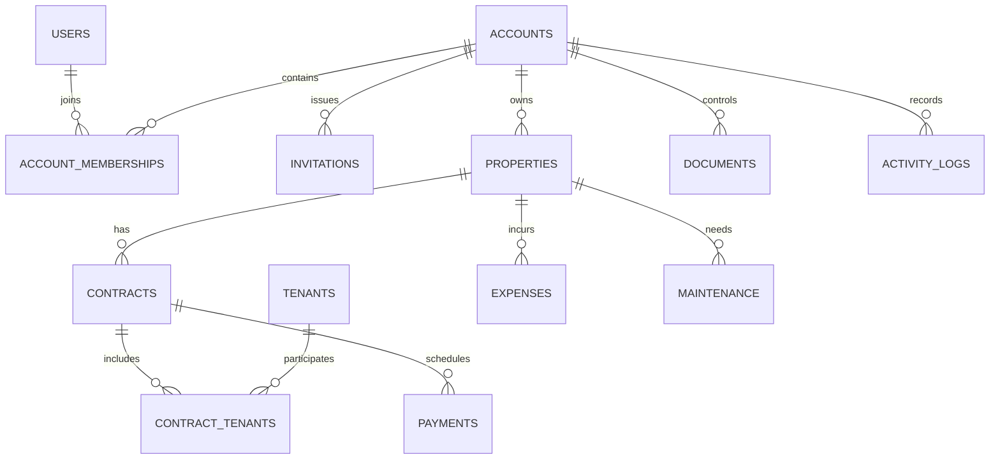

# Database Model

## Status

This is a conceptual model. Exact columns, keys, indexes, constraints, and migration files will be designed during implementation and reviewed against business rules.

## Initial entities

The initial business model includes:

- `users`
- `accounts`
- `account_memberships`
- `invitations`
- Per-membership, per-area access settings
- `properties`
- `tenants`
- `contracts`
- `contract_tenants`
- `payments`
- `expenses`
- `documents`
- `maintenance`
- `notifications`
- `user_preferences`
- `activity_logs`

Authentication may add technical records such as sessions, refresh tokens, email verifications, and password resets.

## Relationships and ownership

Every business record must be scoped to an account, directly or through a parent relationship. A user can belong to multiple accounts. Each membership has its own access level for each application area.

## Integrity requirements

- Use relational relationships, foreign keys, indexes, and constraints.
- A property may retain multiple historical contracts.
- A contract may have multiple tenants through `contract_tenants`.
- Prevent overlapping active contracts for the same property unless a specifically supported arrangement permits them.
- Associate payments with contracts and expenses/maintenance with properties.
- Keep database entities separate from API contracts.
- Avoid large JSON columns for relational data.
- Store timestamps consistently; format them for locale at the presentation boundary.
- Use migrations for schema changes and isolate D1-specific behavior in persistence adapters.
- Keep TEST and PROD databases separate.

## Access and deletion data

Membership access must represent the built-in No access, Viewer, and Editor levels independently for each application area. The account owner alone can manage memberships and permissions.

Deletion must support a 30-day recovery period, followed by permanent deletion. The implementation must define how parent/child records, file objects, and activity history behave during deletion and restoration before migrations are finalized.

## Persistence

Cloudflare D1 is the initial relational database. Local development and tests must use a SQLite-compatible environment without accessing PROD. Keep the persistence implementation modular so a future PostgreSQL migration does not require business-rule rewrites.

File contents are stored in private object storage. The database stores document metadata and storage keys only.
