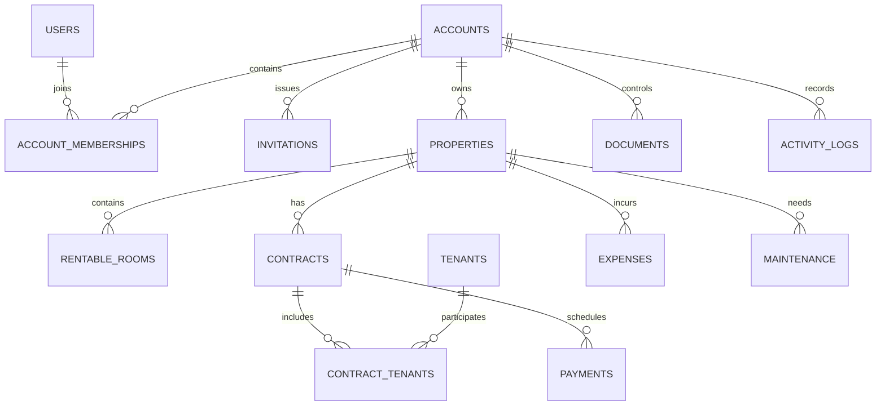

# Database Model

## Status

The first migration implements only users, accounts, memberships, and per-area access. The remaining entities and their fields, lifecycle rules, and migrations are conceptual and must be designed in reviewed feature slices. No API route currently reads or writes the database.

## Implemented account slice

[`0001_accounts.sql`](../apps/api/migrations/0001_accounts.sql) uses opaque text identifiers and UTC creation timestamps:

- `users`: identifier and creation timestamp only. Credentials and profile fields await authentication design.
- `accounts`: identifier and required owner user. A deferred foreign key requires that owner to have a membership in the same account.
- `account_memberships`: composite account/user key, foreign keys to both records, and a user lookup index. A user can join multiple accounts.
- `membership_area_access`: one access level per account, member, and nonempty area, constrained to `no_access`, `viewer`, or `editor`. The composite foreign key prevents granting access to a user who is not a member of that account.

Create an account and its owner's membership in the same transaction. Foreign keys must be enabled for every SQLite connection. Deletions are restricted rather than cascaded; the unresolved retention and erasure rules must be decided before implementing removal. The schema alone does not enforce owner-only administration, interpret missing area entries, or create invitation defaults: authorization and invitation behavior remain future application work.

Local migrations are applied by the Node SQLite adapter in a transaction, with a SHA-256 checksum ledger. Line endings are normalized before checksumming. Applied migrations must not be changed, removed, or reordered; add a new migration instead. Local SQLite and the first schema's constraints are tested, including in an isolated Miniflare D1 database. There is no remote D1 migration or deployment command yet. See [Development](DEVELOPMENT.md) for the local command.

## Initial entities

The initial business model includes:

- `users`
- `accounts`
- `account_memberships`
- `invitations`
- Per-membership, per-area access settings
- `properties`
- `tenants`
- `contracts`
- `contract_tenants`
- `payments`
- `expenses`
- `documents`
- `maintenance`
- `notifications`
- `user_preferences`
- `activity_logs`

Authentication may add technical records such as sessions, refresh tokens, email verifications, and password resets.

## Relationships and ownership

Every business record must be scoped to an account, directly or through a parent relationship. A user can belong to multiple accounts. Each membership has its own access level for each application area.

User preferences include the user's selected visual theme; the database is the authoritative source across sessions, devices, and account switches. Ledger is the default when an account is first created.

## Integrity requirements

- Use relational relationships, foreign keys, indexes, and constraints.
- A property may retain multiple historical contracts.
- A rentable room belongs to one property and has a user-defined name. A contract covers either a whole property or one of its rooms.
- A contract may have multiple signers through `contract_tenants`; optional household counts and pet presence do not create signer records.
- Tenant records belong to an account and may be reused across that account's properties and contracts; they must not be shared across unrelated accounts. User theme preferences remain per-user across accounts.
- Enforce inclusive effective-date overlap rules for signed contracts, including whole-property versus room conflicts, while allowing different rooms to be rented simultaneously. Preserve original signed dates and a separately recorded actual early-end date.
- Track potential renewals pending landlord confirmation so conflicting new signatures are blocked until resolved; design the required persistence and concurrency safeguards before implementation.
- Model expected rent, receipts, allocations, contract-scoped unallocated credit, and non-cash reductions distinctly. Preserve original amounts and correction history. Receipt corrections and reviewed allocation changes must be consistent and must not leave allocations exceeding the corrected receipt. Block deleting a receipt with remaining allocations; restore eligible receipts as unallocated credit without reinstating allocations, while preserving allocation history.
- Block deleting an expected-rent entry with remaining allocations or reductions; preserve the history of their removal and restore eligible entries without automatically reinstating either. Generation skips a period with a recoverable deleted entry and, after purge, uses a separate minimal suppression marker to avoid recreation. Block manual creation until the recoverable entry is restored or the suppressed period is explicitly re-enabled. Do not retain the deleted entry's amount or unnecessary personal data in the marker. Retain the marker until an authorized editor confirms re-enabling the period or the associated data is permanently erased; define privacy/erasure handling and recovery conflicts with replacement entries before implementation.
- Preserve renewal state and confirmed periods, rent schedule and change history, and separate deposit receipts, returns, and deductions. Design schedule-generation and correction schemas with the feature rather than assuming exact table names.
- Allow a tracked deposit balance below zero only after an explicit warning and landlord confirmation. Design confirmation, concurrent changes, and correction history so the warning reflects the current balance.
- Model estimated maintenance costs separately from linked actual expenses so reports do not count the same expense twice.
- Associate payments with contracts and expenses/maintenance with properties.
- Keep database entities separate from API contracts.
- Avoid large JSON columns for relational data.
- Store timestamps consistently; format them for locale at the presentation boundary.
- Use migrations for schema changes and isolate D1-specific behavior in persistence adapters.
- Keep TEST and PROD databases separate.

## Access and deletion data

Membership access must represent the built-in No access, Viewer, and Editor levels independently for each application area. The account owner alone can manage memberships and permissions.

Deletion must support a 30-day recovery period, followed by permanent deletion. The implementation must define how parent/child records, file objects, and activity history behave during deletion and restoration before migrations are finalized.

An otherwise deletable record cannot be deleted while active documents remain attached. A deleted document can only be restored after its deleted associated record is restored; neither restoration automatically restores the other. The record and each document have independent 30-day recovery deadlines. Design purge ordering, concurrency safeguards, and failure handling to honor those deadlines and preserve association integrity.

Property, room, and signer archiving must preserve retained history and follow the restrictions in [Product Requirements](PRODUCT.md#archiving-and-retained-history). Archive state is distinct from soft deletion and its 30-day recovery period. Define remaining document, activity and dependent-record lifecycle behavior before implementation.

## Persistence

Cloudflare D1 is the initial relational database. Local development and tests must use a SQLite-compatible environment without accessing PROD. Keep the persistence implementation modular so a future PostgreSQL migration does not require business-rule rewrites.

File contents are stored in private object storage. The database stores document metadata and storage keys only.
