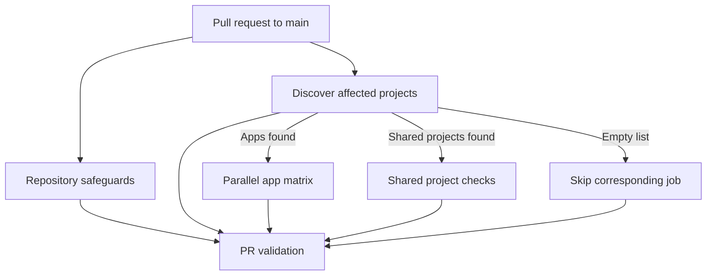

# PR validation

## Purpose

[`execute-pr-validation.yml`](../../../.github/workflows/execute-pr-validation.yml)
protects pull requests with repository checks and affected-project validation.
It does not deploy the application.

## Trigger and concurrency

Runs when a pull request targeting `main` is opened, synchronized, reopened,
edited, or marked ready for review. A newer run for the same PR cancels the
older run; runs for different PRs do not share that concurrency group.

## Inputs and outputs

- Uses the PR base and head commit SHAs, title, number, and body. Exactly one
  Major, Minor, or Patch checkbox must be selected.
- Supplies the lowercase PR head branch as `COMMIT_BRANCH` to Commitlint, so
  every PR commit and title must use its matching uppercase `RENT-xxxxx` scope.
- Reads repository contents and pull requests with read-only permissions. No
  secrets or deployment credentials are required by this workflow.
- Discovery outputs JSON lists of affected apps and non-app projects to later
  jobs. The final **PR validation** job reports the required status check;
  no build artifacts are uploaded.
- Jobs use Node 24.22.3, `npm ci`, and an npm download cache keyed by the
  lockfile. They do not persist `node_modules` or Nx's local task cache.

## Flow

1. **Repository safeguards** checks release selection, patch whitespace, the
   PR title with its squash suffix, and all PR commit subjects. Formatting
   checks changed files unless Prettier configuration or the root dependency
   manifests changed, in which case it checks the workspace. It also checks
   root tooling, its tests, and the Nx graph tests.
2. **Discover affected projects** uses
   [`ci-projects.ts`](../../../scripts/ci-projects.ts) and the PR base/head
   to select projects. Changes in shared projects also select their consumers.
3. **Validate app** runs in parallel for each affected app. It runs available
   lint, type-check, unit-test, and build targets for the whole project. If
   the project has a `test-e2e` target, the job installs Chromium and runs
   that target. The current API build type-checks only; it is not a
   deployable artifact.
4. **Validate affected shared projects** runs available lint, type-check,
   unit-test, and build targets for affected non-app projects. Empty app or
   shared-project lists skip their corresponding jobs.
5. **PR validation** runs even after failures and succeeds only when the
   repository and discovery jobs succeed and each project job succeeds or
   was skipped because its list was empty.

Nx selects projects, not individual dependent test files. Build dependencies
may run in more than one job because the jobs do not share an Nx cache.

## Failure and troubleshooting

Open the failing job and its first failing step in the Actions run. Fix the
reported release selection, commit message, formatting, tooling, or project
failure and push a correction; editing the PR also starts a new run. A failed
or cancelled prerequisite makes the final check fail when the aggregate job
runs. A cancelled workflow may not complete that job at all. Do not treat
skipped project jobs as success unless their affected list is empty.

## Verification

See the [development workflow](../../DEVELOPMENT.md) for setup and local
commands, including graph and browser tests. Run
`node --test scripts/ci-projects.test.ts` to exercise project selection. A
local run does not verify GitHub event data, matrix scheduling, job skips, or
the final required check: inspect an actual PR Actions run after changing the
workflow.

## Related documentation

- [Script reference](../../../scripts/README.md)
- [Testing strategy](../../TESTING.md)
- [Deployment and environments](../../DEPLOYMENT.md)
- [Workflow and script documentation standard](../../DOCUMENTATION.md)
